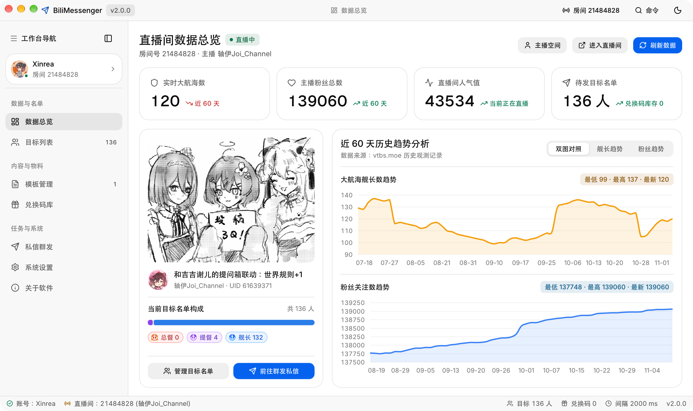

<p align="center">
  
</p>

<h1 align="center">BiliMessenger</h1>

<p align="center">
  Bilibili 舰长私信群发助手<br>
  整理大航海名单、编写私信模板、分发兑换码，让舰长福利发放更省心。
</p>

<p align="center">
  <a href="https://github.com/Xinrea/bili-messenger/actions/workflows/release.yml"></a>
  <a href="https://github.com/Xinrea/bili-messenger/releases/latest"></a>
  <a href="https://github.com/Xinrea/bili-messenger/releases"></a>
</p>

<p align="center">
  <a href="https://github.com/Xinrea/bili-messenger/releases">下载软件</a> ·
  <a href="#快速上手">快速上手</a> ·
  <a href="https://github.com/Xinrea/bili-messenger/issues">问题反馈</a> ·
  <a href="docs/development.md">构建与测试</a>
</p>

## 界面预览



*v2.0 原生版在 macOS 上使用本地数据的实际主界面。直播间信息与历史趋势需要联网加载，展示结果取决于数据源。*

## 下载与安装

前往 **[GitHub Releases](https://github.com/Xinrea/bili-messenger/releases)**，按操作系统和处理器架构选择对应文件，并参考该版本的发布说明安装。

- **macOS**：下载 `BiliMessenger-macOS.zip`，解压后打开应用。
- **Windows x64**（新版工作流提供两种形式）：
  - `BiliMessenger-Windows-x64.exe`：免安装单文件，下载后直接运行，无需附带 DLL 或另装 Visual C++ 运行库。
  - `BiliMessenger-Windows-x64-Setup.exe`：安装程序，为当前用户安装，创建开始菜单快捷方式，可选桌面快捷方式，并支持卸载。
- **Linux**：请参考[构建与测试](docs/development.md)从源码编译。

Windows 两种形式共用 `%APPDATA%\bilimessenger` 中的用户数据；免安装不代表数据保存在 exe 旁，卸载安装版也不会删除用户数据。旧版本的下载文件以对应 Release 为准。

本 README 介绍当前源码中的 **v2.0 原生版**，基于 C99 + [CUI](https://github.com/yappologistic/CUI) 构建，不再依赖 Electron。已发布版本可能与截图、功能说明不同，需要体验当前源码时请自行构建。

## 主要功能

| 功能 | 可以做什么 |
| --- | --- |
| 数据总览 | 查看直播间状态、主播信息、目标名单构成，以及近 60 天的舰长数与粉丝数趋势 |
| 目标列表 | 按历史快照或上舰日期范围获取名单；通过 UID / 用户名添加用户；支持去重、筛选、多选删除和 TXT / CSV 导入导出 |
| 私信模板 | 管理多个模板，快捷插入昵称、航海等级、日期和兑换码等变量，实时预览内容 |
| 兑换码库 | 批量粘贴导入，自动去重、去空行，支持多选删除与清空 |
| 私信群发 | 设置发送间隔，查看发送进度，保留失败目标，并在发送后两分钟内发起撤回 |
| 账号与设置 | 扫码或手动 Cookie 登录、启动时校验登录状态、深浅色主题切换和新版本提示 |

名单数据来自 `guard.vjoi.cn` 与 Bilibili 接口，趋势数据来自 `vtbs.moe`；数据完整性和可用性取决于对应服务。

## 快速上手

1. **登录并绑定直播间**：打开「系统设置」，使用扫码或 Cookie 登录，设置目标直播间。
2. **整理发送对象**：在「目标列表」获取上舰名单，或手动添加、导入用户；发送前核对范围与人数。
3. **准备私信内容**：在「模板管理」创建模板，通过变量插入个性化内容，并检查预览。
4. **按需导入兑换码**：模板使用 `{code}` 时，先在「兑换码库」准备足够的兑换码。
5. **确认后发送**：在「私信群发」选择模板、设置发送间隔，确认目标与内容后再开始发送。

请遵守 Bilibili 平台规则，避免发送骚扰信息。发送与撤回均受平台接口和风控限制；建议先用少量目标验证内容，不要依赖撤回来纠正批量误发。

### 模板变量

| 变量 | 含义 |
| --- | --- |
| `{name}` | 目标用户昵称 |
| `{level}` | 大航海等级或自定义头衔 |
| `{code}` | 从兑换码库取用的兑换码 |
| `{date}` | 当前日期，格式为 `YYYY-MM-DD` |
| `{month}` | 当前月份，1–12 |
| `{lastMonth}` | 上个月份，1–12 |
| `{day}` | 当前日，1–31 |

例如：

```text
{name}，感谢你成为本月的{level}！这是你的专属兑换码：{code}
```

## 数据与迁移

原生版兼容旧版 Electron 的 `config.json` 数据格式，包括登录凭据、舰长列表、私信模板、兑换码和已发送记录。升级或手动迁移前，建议先退出程序并备份配置。

默认配置位置：

| 系统 | 路径 |
| --- | --- |
| macOS | `~/Library/Application Support/bilimessenger/config.json` |
| Windows | `%APPDATA%\bilimessenger\config.json` |
| Linux | `$XDG_CONFIG_HOME/bilimessenger/config.json`，未设置时为 `~/.config/bilimessenger/config.json` |

**配置包含登录凭据和业务数据，请勿公开上传或作为问题反馈附件。**

## 问题反馈

- **软件内反馈**：在「关于软件」→「问题反馈」中填写问题描述，可选填邮箱。支持预览或取消附带诊断日志；关闭弹窗后仍会保留草稿和提交状态。
- **GitHub Issues**：前往 [Issues](https://github.com/Xinrea/bili-messenger/issues) 描述复现步骤、系统和软件版本。请先移除截图或附件中的 Cookie、兑换码及私信内容等敏感信息。

诊断日志仅在提交反馈时上传，不会主动上报。采集范围、隐私处理和重试机制见[反馈与诊断日志](docs/diagnostics.md)。

## 检查更新

启动后会在后台检查 GitHub 最新正式版。发现新版本时显示 Toast，点击「查看更新」可打开发布页查看说明并下载；不会自动下载安装。

也可在「关于软件」点击「检查更新」（设置页仍保留入口）。手动检查会提示已是最新版本或检查失败；自动检查无更新或网络失败时不打扰操作。

## 开发与许可

- [构建与测试](docs/development.md)：依赖安装、编译、运行和单元测试。
- [GNU GPL v3](LICENSE)：项目开源许可。
